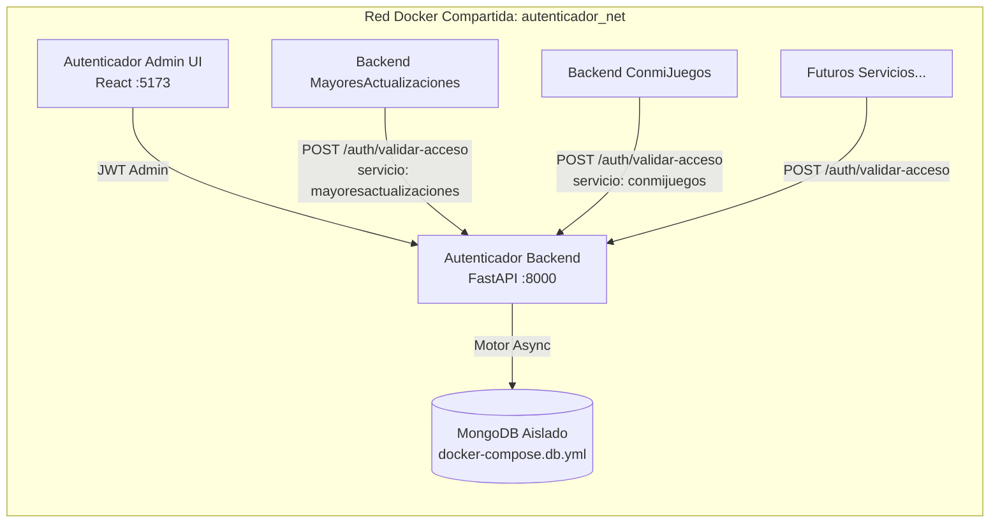

# 🛡️ Autenticador Central — Torre de Control de Usuarios y Servicios

Microservicio centralizado de autenticación, registro, baja y control de permisos por servicio para múltiples plataformas que conviven en un mismo servidor Linux (`mayoresactualizaciones`, `conmijuegos` y futuros servicios).

---

## 📌 ¿Qué es y cómo funciona este proyecto?

En el servidor conviven distintos sistemas independientes (por ejemplo, **Mayores Actualizaciones** y **ConmiJuegos**), cada uno dentro de su propio contenedor de Docker Compose con su propio backend.

El **Autenticador Central** actúa como la **única fuente de verdad de usuarios y permisos**:
1. **Validación de ingreso (`POST /auth/validar-acceso` / `POST /auth/login`)**: Cuando una persona intenta ingresar a `mayoresactualizaciones` o a `conmijuegos` (ya sea con su **Email/Contraseña**, su **PIN de 6 dígitos** o su **Token JWT**), el backend de ese servicio consulta al Autenticador enviando la clave del servicio (`"mayoresactualizaciones"`, `"conmijuegos"`, etc.). El Autenticador verifica en MongoDB:
   - Si el usuario existe.
   - Si su cuenta global está `ACTIVA` (`activo: true`).
   - Si tiene habilitada la clave de ese servicio específico en su mapa de permisos (`servicios.<clave>: true`).
2. **Registro unificado (`POST /auth/register`)**: Cuando un servicio registra a un usuario nuevo, el Autenticador crea la cuenta en MongoDB, le genera automáticamente su PIN de 6 dígitos (`codigoAcceso`) y le activa la clave del servicio de origen (`servicioOrigen`). Si el email ya existía en la base de datos por otro servicio, vincula y habilita automáticamente el nuevo servicio sin duplicar al usuario.
3. **Baja de servicio o baja global (`POST /auth/baja`)**: Permite que un servicio externo desactive únicamente su clave de acceso para ese usuario o procese la baja global de la cuenta.
4. **Consola Web exclusiva para el Administrador (Torre de Control)**: Un frontend ligero en React + Tailwind desde donde el administrador puede visualizar todas las cuentas, filtrar por servicio (`mayoresactualizaciones`, `conmijuegos`, etc.), activar o desactivar el permiso de cada servicio con un clic, cambiar estados (`ACTIVO`, `SUSPENDIDO`, `BAJA`), alternar suscripción `BLACK`, generar **Magic Links** y registrar nuevas claves de servicios sin tocar código.

---

## 🐳 Arquitectura de Contenedores (Base de Datos Aislada)

Para evitar que una actualización, reconstrucción o `docker compose down` del código del Autenticador afecte o elimine por error los datos de los usuarios, la infraestructura está separada en **dos archivos Docker Compose independientes** unidos por una red externa llamada `autenticador_net`:



| Archivo | Contenedores que incluye | Propósito |
| :--- | :--- | :--- |
| **`docker-compose.db.yml`** | `autenticador_mongodb` (`mongo:7.0`) | Mantiene la base de datos en un ciclo de vida aislado con el volumen persistente `autenticador_mongo_data`. **No se detiene ni se toca** cuando se actualiza el backend o el frontend. |
| **`docker-compose.yml`** | `autenticador_backend` + `autenticador_frontend` | Contiene la API FastAPI y la interfaz de administración. Puede actualizarse y reconstruirse (`up -d --build`) en cualquier momento sin riesgo para MongoDB. |

---

## 📂 Estructura del Proyecto

```text
Autenticador/
├── docker-compose.db.yml                # Contenedor exclusivo de MongoDB con volumen persistente
├── docker-compose.yml                   # Contenedores de Backend (FastAPI) y Frontend (Admin UI)
├── README.md                            # Documentación completa del proyecto
│
├── backend/                             # API REST en Python + FastAPI + Motor (MongoDB asíncrono)
│   ├── Dockerfile
│   ├── requirements.txt
│   ├── .env                             # Variables de entorno locales
│   └── app/
│       ├── main.py                      # Punto de entrada FastAPI, CORS, Lifespan y /health
│       ├── core/
│       │   ├── config.py                # Configuración (MONGODB_URL, DATABASE_NAME, JWT_SECRET, FRONTEND_URL)
│       │   ├── database.py              # Conexión Motor a MongoDB, índices y semilla inicial (seed)
│       │   ├── security.py              # Hashing con salt y generación/validación de tokens JWT
│       │   └── dependencies.py          # Guards de seguridad: get_current_user y get_current_admin
│       └── features/
│           ├── auth/                    # Módulo de Autenticación y Comunicación entre Contenedores
│           │   ├── __init__.py
│           │   ├── schemas.py           # Modelos Pydantic de Login, Registro, Validación y Baja
│           │   ├── router.py            # Rutas /auth/login, /auth/register, /auth/validar-acceso, /auth/baja, /auth/me
│           │   └── service.py           # Lógica de negocio y serializador format_user_response
│           └── usuario/                 # Módulo de Administración (Torre de Control)
│               ├── __init__.py
│               ├── schemas.py           # Modelos de UsuarioResponse, Estados, Catálogo de Servicios y Paginación
│               ├── router.py            # Rutas /usuario (filtros, toggles de servicio/activo/black, magic-link, catálogos)
│               └── service.py           # Consultas dinámicas a MongoDB y administración de cuentas
│
└── frontend/                            # Consola Web exclusiva de Administrador (React 18 + TypeScript + Vite + Tailwind)
    ├── Dockerfile                       # Build multi-stage con Nginx para producción
    ├── package.json
    ├── vite.config.ts
    └── src/
        ├── main.tsx                     # Punto de montaje de React
        ├── api.ts                       # Cliente HTTP tipado hacia el Backend (:8000)
        ├── App.tsx                      # Vista de Login Admin + Torre de Control + Simulador de Microservicios
        └── index.css                    # Estilos Tailwind CSS
```

---

## 🗄️ Estructura de Datos en MongoDB (`autenticador_db`)

El backend inicializa automáticamente tres colecciones con sus índices y datos semilla al arrancar:

### 1. Colección `usuarios`
Almacena todas las cuentas del ecosistema junto con el diccionario `servicios` que indica mediante claves booleanas a qué plataformas puede ingresar cada persona:

```json
{
  "id": 2,
  "name": "Marta González",
  "email": "marta.gonzalez@ejemplo.com",
  "codigo_acceso": "123456",
  "tipo_usuario": 1,
  "black": true,
  "activo": true,
  "estado_id": 2,
  "estado_codigo": "ACTIVO",
  "servicios": {
    "mayoresactualizaciones": true,
    "conmijuegos": true
  },
  "date_start": "2026-10-16T19:47:26.275Z",
  "date_end": null
}
```
- `tipo_usuario`: `1` = Usuario / Alumno, `2` = Administrador de la Torre de Control.
- `codigo_acceso`: PIN único de 6 dígitos (compatible con el ingreso rápido por PIN de la plataforma cognitiva y SIPI).
- `servicios`: Objeto clave-valor (`{ "mayoresactualizaciones": true, "conmijuegos": false, ... }`).

### 2. Colección `servicios_catalogo`
Contiene las claves de los servicios registrados en el servidor Linux. Por defecto se crean:
- `mayoresactualizaciones` — *Mayores Actualizaciones (SIPI)*
- `conmijuegos` — *ConmiJuegos (Plataforma de Entrenamiento Cognitivo)*
*(El administrador puede agregar nuevas claves desde el botón **"+ Registrar Clave de Servicio"** en el frontend).*

### 3. Colección `estados_usuario`
Catálogo de estados de cuenta:
- `1`: `PENDIENTE_VERIFICACION` (`permite_login: false`)
- `2`: `ACTIVO` (`permite_login: true`)
- `3`: `SUSPENDIDO` (`permite_login: false`)
- `4`: `BAJA` (`permite_login: false`)

---

## 🔌 Endpoints de la API (Guía de Integración)

### A. Endpoints para los Backends de otros Servicios (`/auth`)

#### 1. Validar si un usuario puede ingresar a un servicio
- **Ruta**: `POST /auth/validar-acceso`
- **Uso**: Llamado por el backend de `mayoresactualizaciones` o `conmijuegos` cuando un usuario intenta iniciar sesión o abrir la app.
- **Body (JSON)** — acepta `email`, `codigoAcceso` (PIN), `userId` o `token`:
  ```json
  {
    "email": "marta.gonzalez@ejemplo.com",
    "servicio": "conmijuegos"
  }
  ```
- **Respuesta exitosa (`200 OK`)**:
  ```json
  {
    "success": true,
    "allowed": true,
    "message": "Acceso permitido al servicio 'conmijuegos'.",
    "token": "eyJhbGciOiJIUzI1NiIs...",
    "user": {
      "id": 2,
      "name": "Marta González",
      "email": "marta.gonzalez@ejemplo.com",
      "codigoAcceso": "123456",
      "tipoUsuario": 1,
      "black": true,
      "activo": true,
      "estadoId": 2,
      "estadoCodigo": "ACTIVO",
      "servicios": {
        "mayoresactualizaciones": true,
        "conmijuegos": true
      }
    }
  }
  ```
  *(Si el usuario no existe, está suspendido o tiene `"conmijuegos": false`, devuelve `"allowed": false` y el motivo en `"message"`).*

#### 2. Registrar un usuario desde un servicio externo
- **Ruta**: `POST /auth/register`
- **Body (JSON)**:
  ```json
  {
    "name": "Carlos López",
    "email": "carlos.lopez@ejemplo.com",
    "servicioOrigen": "mayoresactualizaciones"
  }
  ```
- **Comportamiento**:
  - Si el email no existe: crea el usuario en MongoDB, le genera un `codigoAcceso` (PIN de 6 dígitos) y activa `"mayoresactualizaciones": true`.
  - Si el email ya existía (por ejemplo, creado previamente en `conmijuegos`): le habilita también `"mayoresactualizaciones": true` sobre la misma cuenta unificada.

#### 3. Login directo (con validación opcional de servicio)
- **Ruta**: `POST /auth/login`
- **Body (JSON)**:
  ```json
  {
    "codigoAcceso": "123456",
    "servicio": "conmijuegos"
  }
  ```
  *(También acepta `"email"` y `"password"`).*

#### 4. Dar de baja a un usuario en un servicio o globalmente
- **Ruta**: `POST /auth/baja`
- **Body (JSON)**:
  ```json
  {
    "email": "marta.gonzalez@ejemplo.com",
    "servicio": "mayoresactualizaciones"
  }
  ```
  *(Si se envía `"servicio"`, deshabilita únicamente ese servicio para el usuario; si se omite `"servicio"`, pasa la cuenta global a estado `BAJA`).*

---

### B. Endpoints de Administración — Torre de Control (`/usuario`)
*(Todos requieren cabecera `Authorization: Bearer <TOKEN_ADMIN>`)*

| Método | Ruta | Descripción |
| :--- | :--- | :--- |
| `GET` | `/usuario` | Lista paginada con filtros por `nombre` (nombre, email o PIN), `servicio` (`mayoresactualizaciones`, `conmijuegos`), `activo`, `black`, `tipoUsuario`, `fechaDesde`, `fechaHasta` y `orden`. |
| `GET` | `/usuario/{user_id}` | Obtiene el detalle completo de un usuario por su ID. |
| `POST` | `/usuario` | Crea un usuario directamente desde la Torre de Control eligiendo sus servicios activos. |
| `PUT` | `/usuario/{user_id}/toggle-servicio/{servicio_clave}` | **Habilita o deshabilita** el acceso de un usuario a un servicio específico (ej. `mayoresactualizaciones` o `conmijuegos`). |
| `PUT` | `/usuario/{user_id}/toggle-activo` | Activa o suspende la cuenta global del usuario. |
| `PUT` | `/usuario/{user_id}/toggle-black` | Activa o desactiva la suscripción **Black** (alias: `/usuario/{user_id}/suscribirse`). |
| `PUT` | `/usuario/{user_id}/estado` | Cambia el estado de la cuenta según el catálogo (`ACTIVO`, `SUSPENDIDO`, `BAJA`, etc.). |
| `POST` | `/usuario/{user_id}/magic-link` | Genera un token JWT y enlace directo `/acceso?token=...` junto con el PIN del alumno. |
| `GET` | `/usuario/servicios/catalogo` | Lista todos los servicios registrados en el Autenticador. |
| `POST` | `/usuario/servicios/catalogo` | Registra una nueva clave de servicio (para futuros contenedores). |
| `GET` | `/usuario/estados/catalogo` | Lista el catálogo de estados de usuario. |
| `POST` | `/usuario/estados/catalogo` | Crea un nuevo estado personalizado en el catálogo. |

---

## 🖥️ ¿Qué incluye el Frontend de Administrador?

El frontend (`http://localhost:5173`) es de **uso exclusivo para el Administrador** y ofrece:
1. **Login de Administrador protegido**: Solo permite el ingreso a cuentas con rol `tipoUsuario = 2`.
2. **Tarjetas de Resumen y Filtro Rápido por Clave**: Muestra el total de usuarios y cuántos tienen permiso activo en `mayoresactualizaciones`, `conmijuegos`, etc.
3. **Tabla Interactiva de Cuentas**:
   - Visualización de ID, Nombre, Email y **PIN de 6 dígitos**.
   - **Botones de Permiso por Servicio** en cada fila: Con un solo clic sobre el botón `mayoresactualizaciones` o `conmijuegos` se habilita (verde) o deshabilita (gris) el acceso de ese usuario a dicho contenedor.
   - Selector de Estado (`ACTIVO`, `SUSPENDIDO`, `BAJA`, `PENDIENTE_VERIFICACION`).
   - Botón para alternar suscripción **BLACK**.
   - Botón para generar y copiar el **Magic Link** y el PIN del usuario.
4. **Modal "Nuevo Usuario"**: Permite dar de alta una cuenta eligiendo con casillas qué servicios tendrá habilitados.
5. **Modal "+ Registrar Clave de Servicio"**: Permite agregar nuevos servicios al ecosistema (ej. `aulasvirtuales`) que aparecen inmediatamente como columnas/botones en toda la tabla.
6. **Probador de Integración en Vivo**: Panel inferior que simula la petición `POST /auth/validar-acceso` de cualquiera de los contenedores y muestra la respuesta JSON en tiempo real.

---

## 🚀 Cómo Ejecutar el Proyecto

### Opción 1: Ejecución Local (Desarrollo)

1. **Asegurar que MongoDB esté corriendo en `localhost:27017`**.
2. **Levantar el Backend (Puerto `8000`)**:
   ```bash
   cd backend
   pip install -r requirements.txt
   python -m uvicorn app.main:app --host 0.0.0.0 --port 8000 --reload
   ```
   - Documentación interactiva Swagger: `http://localhost:8000/docs`
3. **Levantar el Frontend Admin (Puerto `5173`)**:
   ```bash
   cd frontend
   npm install
   npm run dev
   ```
   - Abrir en el navegador: `http://localhost:5173`

### Opción 2: Despliegue con Docker Compose en Servidor Linux

```bash
# 1. Crear la red externa compartida (solo se ejecuta la primera vez en el servidor)
docker network create autenticador_net

# 2. Levantar el contenedor de Base de Datos MongoDB aislado
docker compose -f docker-compose.db.yml up -d

# 3. Levantar (o actualizar) el Backend y el Frontend del Autenticador
docker compose up -d --build
```
> **Nota para conectar los otros contenedores (`mayoresactualizaciones`, `conmijuegos`, etc.)**:
> Agregando la red externa `autenticador_net` en el `docker-compose.yml` de cada servicio externo, sus backends podrán comunicarse directamente con el Autenticador mediante `http://autenticador_backend:8000/auth/validar-acceso` sin pasar por internet público.

---

## 🔑 Credenciales Iniciales de Prueba (Semilla Automática)

Al iniciar por primera vez, el sistema crea las siguientes cuentas de prueba en MongoDB:

| Rol | Nombre | Email | Contraseña | PIN (`codigoAcceso`) | Servicios Activos |
| :--- | :--- | :--- | :--- | :--- | :--- |
| **Administrador** | Administrador Central | `admin@autenticador.com` | `admin123` | `999999` | `mayoresactualizaciones`, `conmijuegos` |
| **Usuario (Black)** | Marta González | `marta.gonzalez@ejemplo.com` | `123456` | `123456` | `mayoresactualizaciones`, `conmijuegos` |
| **Usuario** | Roberto Carlos Méndez | `roberto.mendez@ejemplo.com` | `654321` | `654321` | Solo `conmijuegos` |
| **Suspendido** | Elena Beatriz Gómez | `elena.gomez@ejemplo.com` | `112233` | `112233` | `mayoresactualizaciones` (Cuenta inactiva) |
